<!-- ================================================= -->
<!-- ATTILA EKA PUTRA | ROYAL AI KINGDOM V3            -->
<!-- GitHub Profile: Attilaekaputra1                   -->
<!-- ================================================= -->

<!-- ROYAL AI HERO -->

 

  

  

# 👑 THE ROYAL AI EXPERIENCE

### Think Beyond Limits. Create Beyond Imagination.

*Where intelligence meets creativity, technology, and meaningful collaboration.*

---

# 🧑‍💻 CHARACTER PROFILE

<table>
<tr>
<td width="50%" valign="top">

### 👑 PERSONAL IDENTITY

**Name**

Attila Eka Putra

**Professional Position**

Applied AI & Partnership Specialist

**Primary Focus**

Artificial Intelligence & Prompt Engineering

**Programming Languages**

JavaScript & Python

</td>
<td width="50%" valign="top">

### 🚀 PROFESSIONAL MISSION

Exploring the intersection of artificial intelligence, creative technology, and strategic partnerships.

Transforming ideas into intelligent solutions through innovation, experimentation, and meaningful collaboration.

**Mindset:** Think. Explore. Create. Innovate.

</td>
</tr>
</table>

---

# 🧠 THE INTELLIGENCE CORE

*Exploring the limitless possibilities of artificial intelligence.*

<table>
<tr>
<td width="50%" valign="top">

### 🤖 APPLIED ARTIFICIAL INTELLIGENCE

- Generative AI exploration
- AI-powered solutions
- Intelligent workflows
- AI experimentation
- Creative automation

</td>
<td width="50%" valign="top">

### ✨ PROMPT ENGINEERING

- Advanced prompt design
- Text-to-image prompting
- Text-to-video prompting
- Prompt optimization
- Structured AI workflows

</td>
</tr>
<tr>
<td width="50%" valign="top">

### 💻 PROGRAMMING & DEVELOPMENT

- JavaScript
- Python
- Programming fundamentals
- Workflow experimentation
- Technical problem solving

</td>
<td width="50%" valign="top">

### 🤝 PARTNERSHIP & INNOVATION

- Strategic partnerships
- Technology collaboration
- Partnership development
- Digital transformation
- Innovation initiatives

</td>
</tr>
</table>

---

# ⚡ TECHNOLOGY ARSENAL

### PROGRAMMING LANGUAGES

  

### DEVELOPMENT ENVIRONMENT

  

### ARTIFICIAL INTELLIGENCE

---

# 🔮 THE INNOVATION PROTOCOL

*My approach to turning ideas into intelligent possibilities.*

<table>
<tr>
<td align="center" width="20%">

💡

**01**

**IDEATE**

</td>
<td align="center" width="20%">

🔍

**02**

**EXPLORE**

</td>
<td align="center" width="20%">

🧠

**03**

**ENGINEER**

</td>
<td align="center" width="20%">

⚙️

**04**

**DEVELOP**

</td>
<td align="center" width="20%">

🚀

**05**

**INNOVATE**

</td>
</tr>
</table>

*Great innovation begins with curiosity and grows through experimentation.*

---

# 📊 GITHUB POWER LEVEL

*My development activity, programming statistics, and coding evolution.*

 

  

### ⚡ EVERY CONTRIBUTION BUILDS THE KINGDOM.

---

# 🌌 ROYAL AI UNIVERSE

*An ecosystem of intelligence, imagination, and endless possibilities.*

### 👑 INTELLIGENCE ONLINE

**THINK BEYOND LIMITS. CREATE BEYOND IMAGINATION.**

---

# 🌐 CONNECT WITH ME

**Let's connect, collaborate, and create something extraordinary.**

 

  

  

### 👑 RULE YOUR IDEAS. BUILD YOUR FUTURE.

*Keep learning. Keep creating. Keep evolving.*

 

