<!-- ROYAL AI HERO -->

 

  

  

### 👑 THE ROYAL AI EXPERIENCE

**Think Beyond Limits. Create Beyond Imagination.**

*Welcome to my digital kingdom — where intelligence meets creativity.*

---

# ⚔️ CHARACTER PROFILE

<table>
<tr>
<td width="50%" valign="top">

### 👑 Identity

**Name:** Attila Eka Putra

**Role:** Applied AI & Partnership Specialist

**Specialty:** AI Prompt Engineering

**Status:** Always Exploring

</td>
<td width="50%" valign="top">

### 🚀 Mission

Exploring the intersection of artificial intelligence, creative technology, and strategic collaboration.

Turning ideas into intelligent possibilities and meaningful digital solutions.

</td>
</tr>
</table>

---

# 🧠 THE INTELLIGENCE CORE

*My interests, skills, and technological playground.*

<table>
<tr>
<td width="50%" valign="top">

### 🤖 Applied Artificial Intelligence

- Generative AI
- AI-powered solutions
- Intelligent workflows
- AI experimentation
- Creative automation

</td>
<td width="50%" valign="top">

### ✨ Prompt Engineering

- Text-to-image prompting
- Text-to-video prompting
- Prompt optimization
- Structured prompting
- AI creative workflows

</td>
</tr>
<tr>
<td width="50%" valign="top">

### 💻 Programming

- JavaScript
- Python
- Development fundamentals
- Workflow experimentation
- Problem solving

</td>
<td width="50%" valign="top">

### 🤝 Partnership & Innovation

- Strategic collaboration
- Partnership development
- Technology ecosystems
- Digital transformation
- Innovation initiatives

</td>
</tr>
</table>

---

# ⚡ TECHNOLOGY ARSENAL

### Programming Languages

### Development Tools

### AI & Creative Technology

---

# 🔮 MY CREATIVE WORKFLOW

<table>
<tr>
<td align="center" width="20%">

### 💡

**01**

**THINK**

</td>
<td align="center" width="20%">

### 🔍

**02**

**EXPLORE**

</td>
<td align="center" width="20%">

### 🧠

**03**

**PROMPT**

</td>
<td align="center" width="20%">

### ⚙️

**04**

**BUILD**

</td>
<td align="center" width="20%">

### 🚀

**05**

**INNOVATE**

</td>
</tr>
</table>

*Every great innovation begins with a curious mind.*

---

# 📊 GITHUB POWER LEVEL

*My development activity and programming statistics.*

 

 

  

---

# 🐍 CONTRIBUTION KINGDOM

*Every contribution is another step in the evolution.*

 

---

# 🌐 ENTER THE KINGDOM

**Let's connect, collaborate, and create something extraordinary.**

 

  

  

### 👑 RULE YOUR IDEAS. BUILD YOUR FUTURE.

*Keep learning. Keep creating. Keep evolving.*

 

